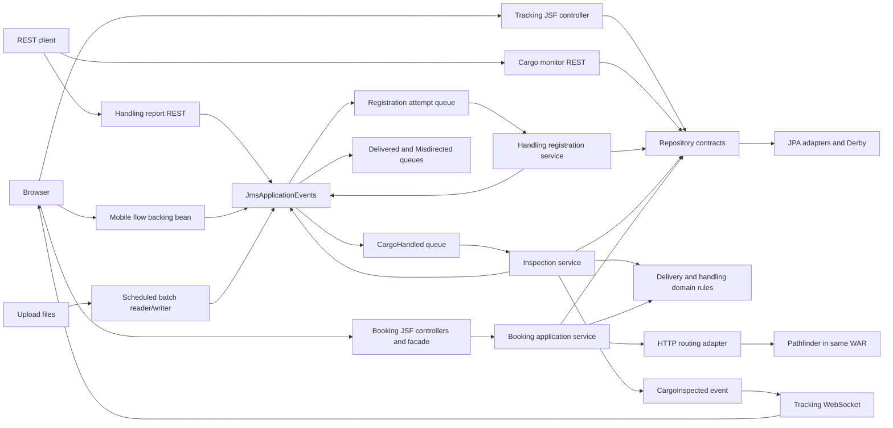

# Legacy baseline: architecture documentation

Prepared 28 October 2026. Source-backed current state at commit `57fc7b32d2597e43b5e0d454e707e0146de5258a`; not a description of the future WildFly/PostgreSQL application. See [verification scope](README.md) and [approved target decisions](../../specifications/modernization-proposal.md).

## System boundary and deployment

One Maven WAR contains Cargo Tracker UI, application/domain logic, persistence adapters, messaging consumers and the pathfinder route simulator. The route adapter calls an HTTP endpoint described as external in its design, but the configured simulator is in the same deployed application. Browser maps/CDN assets are outside this boundary; their current availability and JavaScript behavior were not verified.

The local historical runtime is corrected GlassFish 4.1 on Java 8, with embedded Derby and managed JMS. The WAR declares application data-source/JMS resources. The shared demo publishes HTTP only on host loopback port 8081. Jenkins publishes localhost:8080 and uses a separate agent with no Docker socket. A CI run starts its own disposable native GlassFish inside that agent. These are recorded configuration facts, not a live service-health assertion on this document date.

Diagram arrows show responsibility/call or event flow; they are not a claim that every repository call originates in domain objects. Sources: [pom.xml](https://github.com/javaee/cargotracker/blob/57fc7b32d2597e43b5e0d454e707e0146de5258a/pom.xml), [web.xml](https://github.com/javaee/cargotracker/blob/57fc7b32d2597e43b5e0d454e707e0146de5258a/src/main/webapp/WEB-INF/web.xml), [RestConfiguration](https://github.com/javaee/cargotracker/blob/57fc7b32d2597e43b5e0d454e707e0146de5258a/src/main/java/net/java/cargotracker/application/util/RestConfiguration.java), [ExternalRoutingService](https://github.com/javaee/cargotracker/blob/57fc7b32d2597e43b5e0d454e707e0146de5258a/src/main/java/net/java/cargotracker/infrastructure/routing/ExternalRoutingService.java), [lab deployment files](../../infrastructure/compose.legacy.yaml), [CI implementation](../../ci/baseline.py).

## Layers and boundaries

| Area | Responsibility | Important caveat |
| --- | --- | --- |
| interfaces | JSF controllers/DTO facades, REST, WebSocket, mobile and batch adapters | Several entry points are currently anonymous. Filesystem/scheduled entry points need separate controls in the target. |
| application | Stateless booking/handling/inspection orchestration and event contracts | Container-managed transactions and messaging are part of execution behavior. |
| domain | Cargo, specifications, itinerary, delivery, handling, locations, voyages and repository interfaces | Not perfectly technology-independent: entities contain JPA annotations; BookingBackingBean is a UI/FlowScoped class located under the domain package. |
| infrastructure | JPA repositories, JMS event implementation/consumers, CDI qualifier and routing adapter | Routing uses Jersey/MOXy-specific types; application bootstrap and resources are GlassFish-era configuration. |
| pathfinder | Simulated graph traversal returning candidate routes | Random/current-time simulation is not a real carrier scheduling integration. |

The tracking JSF controller and cargo-monitoring REST resource directly use repositories; mobile/REST/batch handling adapters submit through ApplicationEvents. Not every interface passes through a booking/application-service facade. This is a layered monolith with boundary leaks, not proof of strict dependency isolation. Sources: [Track](https://github.com/javaee/cargotracker/blob/57fc7b32d2597e43b5e0d454e707e0146de5258a/src/main/java/net/java/cargotracker/interfaces/tracking/web/Track.java), [CargoMonitoringService](https://github.com/javaee/cargotracker/blob/57fc7b32d2597e43b5e0d454e707e0146de5258a/src/main/java/net/java/cargotracker/interfaces/booking/rest/CargoMonitoringService.java), [BookingBackingBean](https://github.com/javaee/cargotracker/blob/57fc7b32d2597e43b5e0d454e707e0146de5258a/src/main/java/net/java/cargotracker/domain/model/cargo/BookingBackingBean.java), [ExternalRoutingService](https://github.com/javaee/cargotracker/blob/57fc7b32d2597e43b5e0d454e707e0146de5258a/src/main/java/net/java/cargotracker/infrastructure/routing/ExternalRoutingService.java), [DefaultBookingService](https://github.com/javaee/cargotracker/blob/57fc7b32d2597e43b5e0d454e707e0146de5258a/src/main/java/net/java/cargotracker/application/internal/DefaultBookingService.java), [DefaultCargoInspectionService](https://github.com/javaee/cargotracker/blob/57fc7b32d2597e43b5e0d454e707e0146de5258a/src/main/java/net/java/cargotracker/application/internal/DefaultCargoInspectionService.java).

## Handling sequence and messaging contracts

1. REST/mobile/batch creates a registration attempt. REST does basic parsing/validation; batch parsing differs.
2. JmsApplicationEvents sends an ObjectMessage attempt to HandlingEventRegistrationAttemptQueue, with time-to-live **1000 ms**. This is a source-configured expiration setting, not measured delivery latency or a guarantee that accepted reports survive backlog.
3. HandlingEventRegistrationAttemptConsumer calls the handling service, whose factory resolves entities, builds and persists a HandlingEvent, then publishes a cargo ID to CargoHandledQueue.
4. CargoHandledConsumer invokes inspection, which reads handling history, derives delivery, stores cargo, emits relevant notification messages and fires CargoInspected.
5. The WebSocket observer broadcasts a JSON representation to its registered sessions. Delivered/misdirected consumers currently log notifications; there is no demonstrated email/customer notification integration.

| App-scoped queue (`java:app/jms/` prefix) | Producer / consumer | Payload / behavior |
| --- | --- | --- |
| HandlingEventRegistrationAttemptQueue | JmsApplicationEvents / HandlingEventRegistrationAttemptConsumer | ObjectMessage registration attempt; 1-second TTL configured. |
| CargoHandledQueue | JmsApplicationEvents / CargoHandledConsumer | Text cargo tracking ID → inspection. |
| MisdirectedCargoQueue | JmsApplicationEvents / MisdirectedCargoConsumer | Text tracking ID → log. |
| DeliveredCargoQueue | JmsApplicationEvents / DeliveredCargoConsumer | Text tracking ID → log. |
| RejectedRegistrationAttemptsQueue | Declared resource / RejectedRegistrationAttemptsConsumer | Logging consumer exists, but JmsApplicationEvents has no producer path to this queue. It must not be equated with a verified server dead-letter queue. |

The attempt consumer wraps registration/JMS failures in RuntimeException. Its poison-message comment is not evidence of final server retry/dead-letter behavior. Database changes and event processing cross multiple asynchronous transaction boundaries; end-to-end exactly-once delivery, idempotency and transactional file archiving have not been established.

Sources: [JmsApplicationEvents](https://github.com/javaee/cargotracker/blob/57fc7b32d2597e43b5e0d454e707e0146de5258a/src/main/java/net/java/cargotracker/infrastructure/messaging/jms/JmsApplicationEvents.java), [HandlingEventRegistrationAttemptConsumer](https://github.com/javaee/cargotracker/blob/57fc7b32d2597e43b5e0d454e707e0146de5258a/src/main/java/net/java/cargotracker/infrastructure/messaging/jms/HandlingEventRegistrationAttemptConsumer.java), [DefaultHandlingEventService](https://github.com/javaee/cargotracker/blob/57fc7b32d2597e43b5e0d454e707e0146de5258a/src/main/java/net/java/cargotracker/application/internal/DefaultHandlingEventService.java), [CargoHandledConsumer](https://github.com/javaee/cargotracker/blob/57fc7b32d2597e43b5e0d454e707e0146de5258a/src/main/java/net/java/cargotracker/infrastructure/messaging/jms/CargoHandledConsumer.java), [DefaultCargoInspectionService](https://github.com/javaee/cargotracker/blob/57fc7b32d2597e43b5e0d454e707e0146de5258a/src/main/java/net/java/cargotracker/application/internal/DefaultCargoInspectionService.java), [RejectedRegistrationAttemptsConsumer](https://github.com/javaee/cargotracker/blob/57fc7b32d2597e43b5e0d454e707e0146de5258a/src/main/java/net/java/cargotracker/infrastructure/messaging/jms/RejectedRegistrationAttemptsConsumer.java), [RealtimeCargoTrackingService](https://github.com/javaee/cargotracker/blob/57fc7b32d2597e43b5e0d454e707e0146de5258a/src/main/java/net/java/cargotracker/interfaces/booking/socket/RealtimeCargoTrackingService.java).

## Data model

Logical mapping from annotations and code; this is not exported PostgreSQL DDL or a verified physical-schema catalog.

| Type | Persistence/model relationship |
| --- | --- |
| Cargo | Entity with generated ID, embedded TrackingId, immutable-origin reference, embedded RouteSpecification, Itinerary and Delivery. |
| RouteSpecification / Delivery | Embedded value/snapshot structures referencing locations and (for delivery) voyage/last event. Arrival deadline uses DATE precision; delivery calculation time uses TIMESTAMP. |
| Itinerary / Leg | The embedded Itinerary contains an ordered one-to-many association of Leg entities; each leg references voyage and load/unload locations/times. |
| Voyage / Schedule / CarrierMovement | Voyage entity has embedded voyage number/schedule; schedule owns movements, which reference departure/arrival locations and TIMESTAMP times. |
| HandlingEvent | Entity referencing cargo, location and optional voyage; completion and registration dates use DATE precision. |
| Location | Entity containing embedded UN/LOCODE and a name. |

The persistence unit uses a JTA application data source and automatic schema creation. Startup initializer deletes all seed-domain entities before repopulating. ORM relationship cascade behavior should not be assumed to replace explicit migrations: the initializer itself contains manual delete ordering.

Sources: [Cargo](https://github.com/javaee/cargotracker/blob/57fc7b32d2597e43b5e0d454e707e0146de5258a/src/main/java/net/java/cargotracker/domain/model/cargo/Cargo.java), [Itinerary](https://github.com/javaee/cargotracker/blob/57fc7b32d2597e43b5e0d454e707e0146de5258a/src/main/java/net/java/cargotracker/domain/model/cargo/Itinerary.java), [Leg](https://github.com/javaee/cargotracker/blob/57fc7b32d2597e43b5e0d454e707e0146de5258a/src/main/java/net/java/cargotracker/domain/model/cargo/Leg.java), [Voyage](https://github.com/javaee/cargotracker/blob/57fc7b32d2597e43b5e0d454e707e0146de5258a/src/main/java/net/java/cargotracker/domain/model/voyage/Voyage.java), [Schedule](https://github.com/javaee/cargotracker/blob/57fc7b32d2597e43b5e0d454e707e0146de5258a/src/main/java/net/java/cargotracker/domain/model/voyage/Schedule.java), [CarrierMovement](https://github.com/javaee/cargotracker/blob/57fc7b32d2597e43b5e0d454e707e0146de5258a/src/main/java/net/java/cargotracker/domain/model/voyage/CarrierMovement.java), [HandlingEvent](https://github.com/javaee/cargotracker/blob/57fc7b32d2597e43b5e0d454e707e0146de5258a/src/main/java/net/java/cargotracker/domain/model/handling/HandlingEvent.java), [Location](https://github.com/javaee/cargotracker/blob/57fc7b32d2597e43b5e0d454e707e0146de5258a/src/main/java/net/java/cargotracker/domain/model/location/Location.java), [persistence.xml](https://github.com/javaee/cargotracker/blob/57fc7b32d2597e43b5e0d454e707e0146de5258a/src/main/resources/META-INF/persistence.xml), [SampleDataGenerator](https://github.com/javaee/cargotracker/blob/57fc7b32d2597e43b5e0d454e707e0146de5258a/src/main/java/net/java/cargotracker/application/util/SampleDataGenerator.java).

## Security and operational boundaries

Recorded HTTP tests show anonymous data reads, admin views and state-changing handling input; a valid WebSocket upgrade is accepted with an unrelated Origin. A CORS header test found no grant on cargo JSON, but that does not protect direct clients or authenticate requests. Private WEB-INF/META-INF and missing-resource paths return 404 in the tested cases.

WebSocket source registers sessions on open, removes on close and broadcasts without per-user filtering; it sets a five-minute idle timeout, not an authenticated application-session policy. Abrupt disconnect resilience and actual browser broadcasts remain open. The approved roles/accounts are target requirements only.

Sources: [web.xml](https://github.com/javaee/cargotracker/blob/57fc7b32d2597e43b5e0d454e707e0146de5258a/src/main/webapp/WEB-INF/web.xml), [RealtimeCargoTrackingService](https://github.com/javaee/cargotracker/blob/57fc7b32d2597e43b5e0d454e707e0146de5258a/src/main/java/net/java/cargotracker/interfaces/booking/socket/RealtimeCargoTrackingService.java), [access findings and scope](../../notes/test-coverage-review.md).

## Architecture risks and migration seams

- Demo bootstrap/schema generation and container-local data paths conflict with the approved durable PostgreSQL/Flyway target.
- `javax.*` dependencies, Jersey/MOXy setup, old Faces/PrimeFaces/mobile components and server descriptors need explicit compatibility work.
- Route adapter will need an authenticated internal caller when simulator access is protected; making all endpoints private without this change can break booking.
- Short attempt TTL, replay/concurrency, filesystem deletion/archive behavior and final rejection handling need measured failure tests.
- Domain/package boundary leaks should be evaluated selectively; no wholesale framework rewrite is implied.

The agreed target remains a layered WAR in a WildFly container, Java 25 subject to compatibility, Jakarta EE 11, modernized Faces/PrimeFaces, PostgreSQL and Flyway. Those decisions are documented in the proposal and are **not implemented** by these baseline documents.
