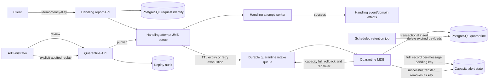

# Handling-message quarantine architecture

## Components and message flow

The source queue sends both expired messages and messages exhausted after three application-handler deliveries to `HandlingAttemptQuarantineIntakeQueue`. The intake address has unlimited delivery attempts with a configurable 30-second default redelivery delay. The disposable WildFly candidate uses a named Artemis data volume so pending intake survives candidate-container replacement. PostgreSQL stores the quarantine payload, alert state, request identity, per-message pending marker and replay audit.

## Transaction and capacity behavior

The quarantine MDB persists a payload and advances its request identity in the same container-managed transaction. A singleton database row is locked before checking the sum of unexpired logical payload bytes and inserting, serializing capacity decisions across concurrent messages. If an item would exceed the configured logical cap, the transaction fails and the broker retains the durable intake message for redelivery. A separate asynchronous transaction records a pending marker keyed by the SHA-256 hash of a stable per-message property set by the application producer before send and activates the full-capacity alert so both survive the failed MDB transaction.

On successful transfer, the same database transaction removes only that message's pending marker. The alert stays active while any marker remains and clears after the last blocked message transfers. This avoids clearing the alert when one of several pending items fits but another remains blocked. Retention deletes only payload rows whose expiry time has passed; it does not clear the alert merely because capacity becomes available.

## Request identity and replay

The REST request reserves a stable ID and payload SHA-256 in `cargo.handling_request_idempotency` before publishing. A uniqueness constraint and transaction serialization protect concurrent same-ID submissions. Same-ID/same-hash returns the original accepted outcome without publishing another message; same-ID/different-hash is rejected. The handling consumer moves the ledger to `PROCESSED`; quarantine moves it to `QUARANTINED`; an Administrator replay returns it to `QUEUED` before publishing and recording audit metadata.

A committed replay removes its active payload row when it queues the message, while the audit remains. If that message later expires or exhausts retries, intake can create a new quarantine row with the same stable request ID. A second replay of the old quarantine row ID is rejected.

The guarantee is bounded to request identities supplied to this application and the transactional queue/database arrangement. Legacy JMS messages without a request property receive a generated ID at quarantine intake. No claim is made of end-to-end exactly-once side effects with external systems.

## Trust boundary

The HTTP resource and service methods require `Administrator`; anonymous, Reader, Operator and service-role denials are checked through the candidate runtime. The intake MDB runs as `HandlingQuarantineWorker`, which has consume access to the intake queue and the minimum service access required to persist and recover messages. The queue security configuration grants source-queue sending and consumption to their designated producer and worker roles.

### Pending transfer identity and alert ordering

Each new producer message carries a unique quarantine message key through expiration and redelivery. Legacy messages use their broker message ID when available; otherwise a stable fingerprint based on registration time and canonical payload is used. Capacity callbacks lock the request ledger row before the shared capacity row, matching the transfer transaction's lock order. A late callback checks that the identity is still queued before adding a pending marker, so it cannot reactivate an alert after the transfer has committed. The alert remains active until every pending marker is resolved.
