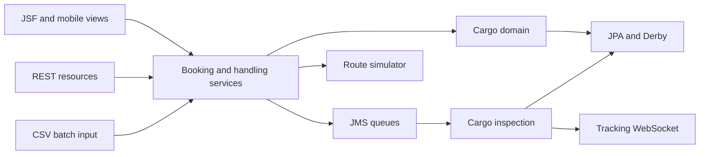

# AI-assisted modernization proposal: Cargo Tracker

**Status:** High-level scope, architecture, technology choices and delivery approach approved; implementation verification and detailed acceptance thresholds remain open. **Created:** 27 October 2026. **Updated:** 1 November 2026. This proposal authorizes no deployments, publication or application changes by itself. Recorded findings are distinguished from proposed decisions. Scope is a local proof of concept; no production customer, budget, deadline or service-level objective has been supplied.

## 1. Objective and success measures

**Approved completion criteria (28 October 2026):** core workflows pass automated service and browser tests; approved access rules pass positive and negative tests; a fresh checkout builds and runs through CI; Flyway migration, persistent storage, backup/restore and rollback are verified; functional, architecture and technical documentation is reviewed and current; performance results and AI assistance are measured and documented; remaining limitations are explicitly recorded and accepted. Numerical performance limits will be agreed after baseline measurement. The AI measurement approach was subsequently agreed in section 7.

Agreed objective (28 October 2026): demonstrate a repeatable, evidence-based method for using AI to modernize a legacy Java application while preserving intended cargo workflows, closing confirmed access gaps and measuring review/rework effort.

| Outcome | Acceptance measure / detail |
| --- | --- |
| Reproducible modern build | A fresh candidate checkout builds and runs in CI using pinned tools and runtime compatible with the agreed target Java version; dependency origins and resulting artifacts are recorded. |
| Preserved business workflows | Booking, route selection/assignment, destination change, tracking and every handling event type pass meaningful tests; browser workflows are exercised, not inferred from HTTP 200. |
| Controlled operational access | Every classified page, API, WebSocket and background entry point has an access rule; anonymous and wrong-role attempts fail, authorized users succeed, and denied mutations leave state unchanged. |
| Explicit behavior changes | Existing defects are tracked separately. Every intentional change, including date validation and error status changes, has an agreed acceptance test. |
| Reliable operations | A container restart retains intended data, startup does not reseed deployed data, and a backup/restore plus rollback rehearsal passes. |
| Measured performance | Record baseline startup, representative request latency and resource use on a defined dataset/load. Agree numerical regression limits before optimizing or declaring equivalence. No measurements exist yet. |
| Verified documentation | Functional, architecture and technical documentation describe the legacy baseline and are updated with every modernization increment. Claims cite source, tests or observed behavior; assumptions and gaps are explicit and reviewed. |
| Auditable AI assistance | Each increment records task, tool/model where known, generated suggestions, review decisions, tests, human corrections, elapsed effort and cost where available. No invented productivity savings. |

AI assists discovery, documentation, test design, migration and review. This proposal does not add an AI feature to Cargo Tracker itself.

Agreed scope includes a working modernized application, migration evidence, reusable AI agent instructions, and AI-generated functional, architecture and technical documentation. Preserve core cargo workflows, address confirmed access-control gaps, verify changes through repeatable tests, and record AI assistance and human corrections. Production deployment and new business features are outside the initial scope. Target architecture, access policy and implementation sequence remain pending decisions.

## 2. Current-state assessment

Verified source: javaee/cargotracker commit `57fc7b32d2597e43b5e0d454e707e0146de5258a`. Repository: `/home/yasinrdp/projects/ai-modernization` in WSL Ubuntu.

| Component | Current implementation and implication |
| --- | --- |
| Packaging/toolchain | One Maven WAR, Java EE 7 APIs, compiler target Java 7; recovered build executes on isolated Java 8. Host tooling uses Java 21. |
| User interface | JSF/Facelets and PrimeFaces 5.2: public tracking, admin views, booking and mobile event-logging flows. Existing direct-link rendering defects are confirmed. |
| Domain/application | Cargo, itinerary, voyage, location, delivery and handling aggregates; application booking, handling and inspection services. Existing interface/application/domain/infrastructure layers provide useful migration boundaries. |
| Persistence | JPA and embedded Derby configured by the WAR. Sample-data initialization and historical dates make this a demo environment, not a production persistence design. |
| Messaging | JMS registration and cargo-processing queues plus CDI events. A 204 report response means acceptance, not necessarily successful handling. Final retry/rejection disposition is not fully tested. |
| Interfaces | REST cargo monitor, handling reports, route graph simulator; `/tracking` WebSocket; CSV/batch input. Route candidates use random/current date behavior. |
| Runtime | GlassFish 4.1 with the documented HK2-277 manifest correction. Shared demo is localhost:8081; Jenkins is localhost:8080. Disposable runtime restart recovery is unresolved. |
| Dependencies | Historical Eclipse dependencies recovered from publisher sources; PrimeFaces theme/plugin rebuilt from pinned official source. Exact historical published-binary equivalence is unverified. |
| CI | Jenkins controller with zero executors; separate non-root Java 21 remoting/Java 8 build agent; hash-recorded local snapshot, not SCM-triggered execution. |
| Test evidence | Build 6 passed 134 reported application cases plus 10 tooling checks. One domain case is empty. Broad browser, role/session, batch, concurrency and resilience coverage is incomplete. |
| Access control | Anonymous operational reads and writes and a cross-origin anonymous WebSocket handshake are confirmed. The separate desired access-control gate fails. No application identity/role system is configured. |

Current interaction flow:

This diagram describes responsibilities, not a complete class/deployment map. The next discovery increment will inventory exact queue consumers, batch triggers, data schema and external assets.

## 3. Recommended target and alternatives

**Agreed modernization approach (28 October 2026): selective modernization.** Preserve useful domain logic and the agreed layered monolith, while allowing technology or design replacement where a documented benefit justifies migration cost and risk. This goes beyond version upgrades without requiring a broad rewrite. Evaluate the runtime, persistence, UI, identity/security and operational tooling separately; no particular replacement is approved by this approach decision alone. Record the reason, alternatives, acceptance tests and rollback plan for each replacement.

**Agreed architecture (28 October 2026):** retain one deployable application with clear internal layers (a layered monolith). Service extraction requires a separately justified decision.

**Agreed Java policy (28 October 2026):** use the latest LTS Java release supported by the selected framework and runtime, with current maintenance updates. Java 25 is the proposed concrete target at the decision date, subject to compatibility verification. Any fallback must document the blocker and receive agreement. This supersedes the original Java 21 target recommendation; historical baseline Java 8 and host Java 21 records remain unchanged.

**Agreed backend platform (28 October 2026):** Jakarta EE 11, subject to Java 25 compatibility verification. Retain useful domain rules and enterprise integrations.

**Agreed application server (28 October 2026):** standard WildFly, not WildFly Preview. WildFly 42 is the initial release-series target at the decision date; select and pin the appropriate maintenance release and image digest during implementation. Verify the application on Java 25 before accepting the runtime combination. Server selection does not establish application compatibility or commercial long-term support.

**Agreed packaging and runtime delivery (28 October 2026):** package the application as a WAR and deploy it in a WildFly Docker container. Version and reproduce the application, server and configuration together, keeping secrets external to the image/source. Preserve the historical GlassFish baseline separately. This is a local lab deployment choice, not approval for production deployment or publication.

**Agreed UI direction (28 October 2026):** retain and modernize Faces/PrimeFaces, preserving workflows while improving usability and fixing broken pages. Selectively replace incompatible screens, including legacy mobile components where necessary. Exact dependency versions and application compatibility remain to be verified; a separate frontend rewrite is not approved.

**Agreed database direction (28 October 2026):** PostgreSQL for the modernized application; historical baseline remains on Derby. Use a separate database container with persistent storage, versioned schema migrations and tested backup/restore. Verify the database migration independently of the Java/Jakarta upgrade. PostgreSQL version remains to be agreed. Schema migration tooling and process were subsequently approved as described below.

**Agreed schema migration tool and process (28 October 2026):** Flyway with versioned SQL migrations committed alongside application changes. Applied migrations are immutable; corrections use new migration versions. AI may draft SQL, but each change requires review of data impact and recovery. CI tests both empty-database creation and upgrades of existing schemas. Run migrations through a dedicated step before the corresponding deployment, with separate migration credentials. Application credentials remain restricted and ORM automatic schema creation/alteration is disabled for deployed candidate environments. For risky changes, use staged compatible changes (expand, migrate, contract); application rollback does not restore deleted database data, so define and test forward correction or backup/restore as appropriate.

**Remaining technical decisions:** access policy and exact runtime/database/tool artifact choices remain pending.

- Use the selected standard WildFly runtime. WildFly 42 supports Jakarta EE 11 and recommends Java 25, while its published Jakarta EE 11 compatibility claims cover Java 17 and 21. Record this distinction and verify our Java 25 combination, including messaging, batch, Faces, persistence and security. Pin the exact maintenance release and image digest in an architecture decision record; choose a maintenance/update practice explicitly. Community compatibility is not a commercial support guarantee. See the [WildFly 42 release announcement](https://www.wildfly.org/news/2026/10/22/WildFly-42-is-released/), checked 28 October 2026. Alternatives were discussed; WildFly was selected without performing a comparative migration trial.
- Retain and modernize Faces/PrimeFaces as approved on 28 October 2026. Preserve workflows, improve usability and fix broken pages; selectively replace incompatible screens rather than starting a separate frontend rewrite. Select a Jakarta-compatible dependency set after verification. PrimeFaces' own migration work includes Java package, tag library and XML namespace changes. The old PrimeFaces mobile flow and theme need a separate compatibility spike; a package rename alone is not an adequate plan.
- Preserve container-managed messaging first. Verify durable queues, failure handling and restart behavior before deciding whether a separate broker is justified.
- Use PostgreSQL for the modernized application, as approved on 28 October 2026, in a separate container with persistent storage. Preserve Derby for the historical baseline. Perform database migration as a separate increment; verify data, dates, transactions and backup/restore explicitly. Use Flyway with versioned SQL migrations and the approved migration process below. Do not combine database replacement with the namespace/runtime migration.
- Keep the existing WSL/Docker/Jenkins lab workflow. Use pinned candidate tools in a separate agent/image or job; do not upgrade the historical baseline job in place.

Alternatives: retain a Java EE-compatible intermediate runtime if the Jakarta UI spike blocks progress; or rewrite around another framework if a concrete requirement justifies replacing EJB/JMS/Faces integrations. A broad rewrite, microservices and Kubernetes are outside the initial scope. Selective replacement of a framework or frontend may be proposed when a concrete limitation and measurable benefit justify it; it requires a separate recorded decision, not incidental AI-generated changes.

Proposed candidate flow: authenticated UI/API clients → server-enforced access checks → existing application/domain services → JPA and managed messaging; WebSocket upgrades and events receive the same authorization boundary. Identity and deployment configuration remain external to domain logic.

Official references, checked 27 October 2026:
- [WildFly getting started and platform variants](https://docs.wildfly.org/42/Getting_Started_Guide.html)
- [WildFly EE 11 / Java 21 compatibility evidence](https://www.wildfly.org/news/2026/05/21/WildFly-40-is-released/)
- [Jakarta EE compatible products](https://jakarta.ee/compatibility/download/)
- [PrimeFaces Jakarta migration work](https://github.com/primefaces/primefaces/issues/11915)

## 4. Proposed access policy

**Approved roles and visibility (28 October 2026):** Reader can view cargo, tracking, dashboards and live updates. Operator has Reader permissions plus booking, routing, destination changes and handling reports. Administrator has Operator permissions plus controlled CSV imports and batch operations. These application roles confer no Jenkins or server administration access. Authorized users initially share organizational cargo visibility; customer-specific ownership/isolation remains a separate decision.

**Approved anonymous-access boundary (28 October 2026):** only landing/about/login pages and necessary static assets are public. All cargo information, tracking, dashboards, operational APIs/functions and live updates require authentication. Predictable tracking IDs are not access credentials. Public customer tracking would need a separate agreed design with a limited view and secure scoped access.

**Still to specify:** detailed session/security configuration, API/internal-caller authentication mechanics and endpoint-specific permission mapping. The initial account approach is approved below. The following matrix applies the approved role responsibilities and anonymous boundary; implementation details still require verification. Three initial roles keep the lab policy reviewable: **Reader**, **Operator**, **Administrator**. An administrator may perform operator/reader actions only through explicit role mapping. Cargo ownership/tenant separation is not implemented; this first policy assumes one trusted organization and shared cargo visibility. Separate booking/handling roles or customer isolation require an expanded policy and tests before those use cases are claimed.

| Surface/action | Anonymous | Reader | Operator | Administrator |
| --- | --- | --- | --- | --- |
| Landing/about, login and necessary static assets | Allow | Allow | Allow | Allow |
| Cargo tracking/details, operational monitor and read-only admin views | Deny | Allow | Allow | Allow |
| Booking, assign/reroute, change destination | Deny | Deny | Allow | Allow |
| Mobile handling and handling-report writes | Deny | Deny | Allow | Allow |
| Tracking WebSocket | Deny | Allow | Allow | Allow |
| Route simulator API | Deny | Deny | Allow/internal caller | Allow |
| CSV import/batch trigger | Deny | Deny initially | Deny initially | Allow through an explicit controlled trigger |
| Server/Jenkins administration | Separate accounts and policy; application roles grant no server administration access. |

Anonymous tracking is excluded by the approved access policy because the current predictable tracking IDs are not proof of entitlement. If public customer tracking is required, agree a limited response and an opaque scoped access token or authenticated ownership model first.

Enforce permissions at HTTP/server and application-service boundaries, including alternate direct URLs and batch triggers; hiding navigation is insufficient. Internal callers use a dedicated mapped identity, not a globally open simulator endpoint. Maintain 401 for unauthenticated APIs and 403 for authenticated insufficient privilege. Page login redirects are limited to appropriate navigation; API clients must not receive a login HTML page as a successful response. WebSocket denial occurs before upgrade; permitted origins are explicit, logout/session expiry terminates authorization, and authorization is checked before broadcasting data.

**Approved initial authentication (28 October 2026):** use WildFly-managed local accounts with application sessions and explicit role mappings for the local proof of concept. Do not build a custom password system. Keep credentials outside Git and container images. Verify login, logout, session expiry and access for each role. External identity-provider/single-sign-on integration remains a later option, not part of the initial implementation. Validate the exact WildFly security configuration in the compatibility/security spike; API and internal service authentication mechanics and account lifecycle details remain to be specified. Include CSRF protection for cookie-authenticated mutations, session expiry/logout tests and safe error responses. Batch identities must be tested separately from interactive users.

## 5. Migration increments and completion gates

**Approved execution order (28 October 2026):** follow the sequence below, maintaining documentation and tests at every step and keeping the historical baseline available for comparison. The order and overall completion criteria are agreed; numerical performance thresholds remain pending baseline measurement. Increment-specific technical checks refine those criteria. Review and commit pending baseline work as a preparatory checkpoint; publishing remains a separate action.

| Increment | Work and deliverable | Completion gate / technical detail |
| --- | --- | --- |
| 1. Document baseline and verify compatibility | Document existing functionality, architecture and technical setup first. Inventory routes, actions, schema, queues, batch triggers and external assets. Define desired security tests and verify a minimal candidate application on Java 25/standard WildFly. | Reviewed, evidence-linked baseline documentation; entrypoint-to-policy map; failing desired-security tests reproduce gaps; compatibility result and exact runtime choice recorded. |
| 2. Implement authentication and roles | Create a versioned candidate source tree derived from pinned source, retaining notices. Configure approved local accounts, sessions and role mappings. Protect operational reads/writes and extend checks to all mapped surfaces. | Authorized actions succeed; anonymous/wrong-role/direct access is denied; rejected writes cause no queued/persisted change; login/logout/session expiry tests pass. |
| 3. Modernize platform and UI | Complete the agreed Java/Jakarta migration and build/test integration. Modernize Faces/PrimeFaces, selectively replacing incompatible screens and fixing direct-view defects. Carry access rules forward. | Reproducible build/deployment; critical browser workflows, REST and actual WebSocket delivery pass; approved behavior changes are documented. |
| 4. Migrate persistence | Migrate to PostgreSQL separately using Flyway. Externalize configuration, isolate migration/application credentials, disable deployed demo reseeding and test both fresh and upgrade paths. | Verified data/date/transaction behavior, durable storage and schema history; no destructive startup; migration and recovery evidence available. |
| 5. Verify resilience, performance and recovery | Complete negative booking, missing domain assertions, replay/order/concurrency, CSV, JMS retries/rejection and abrupt-disconnect checks. Measure performance, wire reviewed SCM CI and rehearse backup/restore and rollback. | Agreed performance/security/recovery criteria pass; meaningful failures block delivery; original empty TODO is resolved or explicitly accepted as a limitation. |
| 6. Evaluate and hand off | Compare functionality/security/recovery outcomes and measured AI effort. Finish documentation, operations notes, demo walkthrough and reproducible AI agent instructions. | Completion checklist reviewed; outstanding limitations and follow-up work clearly identified. |

The compatibility check in increment 1 determines where the first security slice can run. Prefer implementing it on the candidate runtime once a minimal compatible slice starts; if that is blocked, use an isolated legacy-compatible candidate temporarily and port it in increment 3. Record this choice rather than requiring a speculative security implementation on an unproven stack.

## 6. Test and rollback strategy

Keep two explicit contracts: the historical baseline characterizes what the old application does, while the candidate suite asserts intended behavior. Do not carry anonymous-200 or invalid-input-500 expectations forward as requirements. Map retained business cases to the candidate suite and record each deliberate exception; test count alone is not an acceptance criterion.

The candidate gate must cover: every allowed role/action; anonymous/wrong-role/direct access; missing/expired/logout sessions; invalid IDs and payloads; no state change on rejected writes; all five handling event types; successful booking/route/destination flows; actual browser and WebSocket behavior; messaging failures and recovery. Add dependency/security analysis and investigate findings; a scanner pass alone does not certify security.

Each increment produces a small reviewable change, test/evidence bundle and rollback note. Run candidate services on separate ports and data volumes, leaving the shared legacy demo intact. Rollback means selecting the previous artifact/configuration and restoring a compatible data snapshot when a schema change requires it. Merely reverting Git does not reverse database or queued-message changes. Rehearse rollback before declaring it available.

## 7. AI evidence and documentation

**Approved AI measurement approach (28 October 2026):** keep a short record for each meaningful task describing what AI produced (analysis, documentation, code or tests), what was accepted/corrected/rejected and why, verification results, human review/rework time, elapsed task time and usage cost where available. Mark unavailable measurements as unavailable; do not invent retrospective values. Report observed outcomes without claiming hours saved unless there is a measured comparison.

### Agreed documentation deliverables (28 October 2026)

| Documentation set | Required contents |
| --- | --- |
| Functional | Users and roles, workflows, business rules, validation and error scenarios. |
| Architecture | Current and target architecture, components, integrations, data flows and architecture decision records. |
| Technical | Setup, build, APIs, data model, security, testing, deployment, troubleshooting and recovery. |

Document the legacy baseline first. Update the documentation with each modernization increment, distinguishing observed current behavior from proposed target behavior. AI-generated claims must be checked against source code, tests or observed behavior, with traceable references. Mark assumptions, unverified areas and known gaps explicitly. Documentation is a core reviewed deliverable, not an end-of-project afterthought. Technical deployment documentation covers the local lab and recovery; it does not expand scope to production deployment.

Record a short per-increment entry in repository notes: objective, source baseline, AI suggestions accepted/rejected, files changed, human decisions, failing-before/passing-after tests, actual time/cost when available, and unresolved questions. Do not infer human-equivalent time saved without a measured comparison. No secrets, credentials or sensitive customer data belong in prompts, snapshots or evidence.

Use the existing legacy baseline skill for recovery work. After an increment is verified, turn its record into agent instructions with prerequisites, exact inputs, actions, expected outputs, verification, recovery and stop conditions. Keep this proposal and changing project facts separate from reusable skill rules.

## 8. Decisions for agreement

| Decision | Agreed direction / remaining detail | Status |
| --- | --- | --- |
| Purpose and scope | Local AI-assisted modernization proof of concept, verified documentation in three sets, migration evidence and reusable agent instructions; production deployment/new business features excluded initially | Agreed 28 October 2026 |
| Documentation | AI-generated functional, architecture and technical documentation; baseline first, verified and maintained with each increment | Agreed 28 October 2026 |
| Application architecture | One deployable application with clear internal layers (layered monolith) | Agreed 28 October 2026 |
| Modernization depth | Selective modernization: preserve useful domain logic and layered monolith; allow justified technology/design replacements | Agreed 28 October 2026 |
| Java version policy | Latest LTS Java supported by the selected framework/runtime, with current maintenance updates; Java 25 is the proposed concrete target as of 28 October | Policy approved 28 October 2026; Java 25 target subject to compatibility verification; any fallback requires agreement |
| Enterprise backend platform | Jakarta EE 11 | Approved 28 October 2026, subject to Java 25 compatibility verification; WildFly selected separately |
| Application server | Standard WildFly (not Preview); WildFly 42 is the initial release-series target as of 28 October | WildFly selected 28 October 2026; exact maintenance release/image digest and Java 25 compatibility verification pending |
| Packaging and runtime delivery | WAR deployed in a WildFly Docker container; reproducibly version the application, server and configuration together; preserve the historical GlassFish baseline separately | Approved 28 October 2026 |
| Schema migrations | Flyway with immutable versioned SQL migrations; reviewed changes, fresh/upgrade CI tests, dedicated pre-deployment migration step, restricted application credentials and explicit recovery plans | Approved 28 October 2026; exact Flyway version remains to be selected |
| Application roles and visibility | Reader: cargo/tracking/dashboards/live updates; Operator: Reader plus booking/routing/destination changes/handling reports; Administrator: Operator plus controlled CSV imports/batch operations. Shared organizational cargo visibility; no Jenkins/server administration rights | Approved 28 October 2026; customer ownership isolation is a separate decision |
| Anonymous access | Only landing/about/login and necessary static assets are public. All cargo information, tracking, dashboards, operational APIs/functions and live updates require authentication. Predictable cargo IDs confer no access rights; any future public tracking design requires separate agreement | Approved 28 October 2026 |
| Initial authentication | WildFly-managed local accounts, application sessions and explicit role mappings; credentials outside Git and container images; verify login/logout/session expiry and role access. External identity-provider/SSO integration remains a later option | Approved 28 October 2026; exact security configuration and account lifecycle details require implementation verification |
| UI scope | Retain and modernize Faces/PrimeFaces, preserve workflows, improve usability and fix broken pages; selectively replace incompatible screens, especially legacy mobile components | Approved 28 October 2026; exact dependency versions and compatibility verification pending; no separate frontend rewrite approved |
| Persistence | PostgreSQL for the candidate application in a separate container with persistent storage; preserve Derby in the historical baseline; migrate independently from the Java/Jakarta upgrade and verify data, dates, transactions and backup/restore | Approved 28 October 2026; PostgreSQL version remains pending; schema migration tooling/process approved separately |
| Completion | Core service/browser workflows and positive/negative access tests pass; fresh checkout builds/runs through CI; Flyway migration, durable storage, backup/restore and rollback verified; all three documentation sets reviewed/current; performance and AI contribution measured/documented; remaining limitations explicitly recorded and accepted | Approved 28 October 2026; numerical performance limits to be agreed after baseline measurement |
| AI measurement | Per meaningful task: AI output, accepted/corrected/rejected suggestions and reasons, verification, human review/rework time, elapsed task time and cost where available; no unmeasured savings claims | Approved 28 October 2026 |
| Work tracking | Use Jira for epics, stories/tasks, confirmed bugs and compatibility spikes; link versioned Git documentation/code and Jenkins evidence | Jira adoption approved 28 October 2026; connected AI Team (KAN) backlog created: 6 epics and 21 work items, mapped in jira-backlog.md |
| Execution order | Baseline functional/architecture/technical documentation; security tests and minimal Java 25/WildFly compatibility check; authentication/roles; platform/UI modernization; PostgreSQL/Flyway migration; resilience/performance/recovery verification. Maintain documentation/tests throughout and preserve the historical baseline | Approved 28 October 2026 |

The high-level decisions above are agreed. Exact product/library versions, image digests, compatibility results, detailed security configuration and numerical performance thresholds remain implementation details to verify. Decisions that change an agreed direction or require a compatibility fallback will return for explicit agreement; numerical performance limits will be proposed after baseline measurement.

Next planned implementation action under the agreed sequence: document the legacy baseline, inventory entrypoints and policy, then define desired security tests and verify minimal Java 25/WildFly compatibility. This document is the proposal; implementation, dependency upgrades and access-policy changes have not been performed.

## Implementation progress

28 October 2026: Jira adoption approved. The [initial backlog](jira-backlog.md) was created in the explicitly approved AI Team (KAN) Jira project: 6 epics and 21 work items, verified by read-back with epic parents. Jira references are retained in jira-issue-map.json; existing project issues and configuration were preserved.

28 October 2026: produced the [functional, architecture and technical legacy baseline documentation](../docs/baseline/README.md), checked against 37 cited source files and archived execution evidence. Source identities, local links and key declarations were checked; no live compatibility or security implementation result is claimed. User documentation acceptance was received 1 November 2026, with authorization to commit and push. The remaining increment-1 work is the detailed entrypoint/policy inventory, desired-security tests and minimal Java 25/WildFly compatibility verification.

## Supporting evidence

- [Brief work history](../notes/work-completed-brief.md)
- [Setup status](../notes/setup-status.md)
- [Legacy build](../notes/legacy-baseline.md) and [runtime recovery](../notes/legacy-runtime.md)
- [Coverage/access findings](../notes/test-coverage-review.md)
- [Jenkins build 6 summary](../notes/evidence/coverage-review-2026-10-27/jenkins-build-6-summary.json)

## KAN-12 policy mapping (1 November 2026)
Source inventory and desired-policy mapping are available in [access-policy-map.md](access-policy-map.md), with a reproducible JSON census/generator. They map the approved roles and anonymous boundary to pages, actions, APIs, WebSocket, internal calls and background controls. No access implementation or live security test pass is claimed. Detailed worker/internal caller authentication remains to be verified in the candidate runtime.

## Separate-agent review decision (1 November 2026)
The user approved [separate-agent review as standard workflow](../docs/agent-review-workflow.md) for substantive code and documentation changes. Authoring, fresh-context review, correction/recheck and recorded evidence are distinct; user decisions remain required for business/access/scope changes and accepted material limitations. Minor non-semantic edits use a lighter documented check. This is a workflow requirement, not a claim that CI enforcement or historical independent reviews exist.
